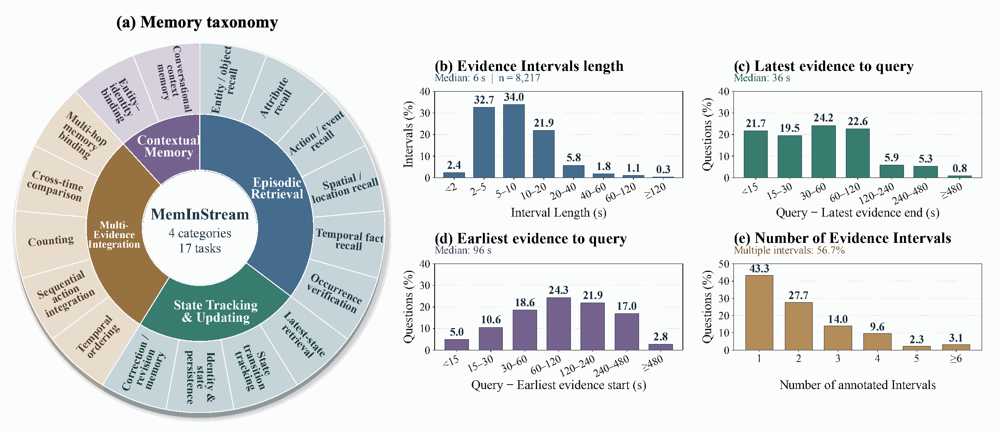

<div align="center">


<h3>Memorizing or Merely Recognizing?<br>Rethinking Streaming Video Memory Evaluation</h3>

<p>
Zhenqi He<sup>1</sup>, Dunyuan Xu<sup>2</sup>, Yang Bo<sup>3,†</sup>, Kien T. Pham<sup>1</sup>, Yanghao Wang<sup>1</sup>, Shuhan Li<sup>3</sup>, Xintong Guo<sup>3</sup>,<br>
Yuyang He<sup>3</sup>, Fang Liu<sup>4</sup>, Huankang Guan<sup>3</sup>, Jingyan Chen<sup>3</sup>, Rui Liu<sup>3</sup>, Long Chen<sup>1,*</sup>
</p>

<p><sup>1</sup>HKUST &nbsp; <sup>2</sup>CUHK &nbsp; <sup>3</sup>Huawei Research &nbsp; <sup>4</sup>CityU</p>

<p><sup>†</sup>Project Leader &nbsp; <sup>*</sup>Corresponding Author</p>

<p><a href="mailto:zheci@connect.ust.hk">zheci@connect.ust.hk</a> &nbsp;·&nbsp; <a href="mailto:longchen@ust.hk">longchen@ust.hk</a></p>

<p>
<a href="https://hkust-longgroup.github.io/MemInStream"></a>
<a href="https://huggingface.co/datasets/zizi32/v1"></a>
</p>

</div>

MemInStream is a benchmark for evaluating **memory in streaming video understanding**. It tests whether models retain, update, retrieve, and integrate historical information as a video unfolds.

Each question is associated with a query timestamp and temporally localized evidence intervals. Our evidence-controlled validation protocol examines both **memory solvability**—whether a question can be answered when the required evidence is available—and **memory necessity**—whether answering it depends on that historical evidence. Contextual memory tasks additionally require information established in earlier dialogue.

## Benchmark Statistics



*From Figure 3 of the paper: (a) the memory taxonomy; (b) evidence interval lengths; (c–d) temporal distances from the latest and earliest evidence to the query; and (e) the number of evidence intervals per question.*

| Item | Count |
| --- | ---: |
| Questions | 3,799 |
| Annotated evidence intervals | 8,217 |
| Major memory categories | 4 |
| Fine-grained tasks | 17 |

Each question has **2.16 evidence intervals on average**, and **56.7%** require multiple intervals. The median evidence interval lasts **6 seconds**. The median distances from the latest evidence end and earliest evidence start to the query are **36 seconds** and **96 seconds**, respectively.

### Memory Taxonomy

The taxonomy covers the following memory capabilities:

| Category | Tasks |
| --- | --- |
| **Episodic Retrieval** | Entity / Object Recall; Attribute Recall; Action / Event Recall; Spatial / Location Recall; Temporal Fact Recall; Occurrence Verification |
| **State Tracking & Updating** | Latest-State Retrieval; State Transition Tracking; Identity & State Persistence; Correction / Revision Memory |
| **Multi-Evidence Integration** | Temporal Ordering; Sequential Action Integration; Counting; Cross-Time Comparison; Multi-hop Memory Binding |
| **Contextual Memory** | Entity–Identity Binding; Conversational Context Memory |

## Download the Videos

### 1. Install the download tool

Use Python 3.10 or later:

```bash
python -m pip install -U huggingface_hub
```

The video repository is public. Authentication is normally unnecessary; if Hugging Face requests authentication, run `hf auth login` and use your own Hugging Face token.

### 2. Download all archives

Run the following command from the root of this repository:

```bash
hf download zizi32/v1 \
  --repo-type dataset \
  --include "videos_*.zip" \
  --local-dir ./data/MemInStream
```

This downloads `videos_001.zip` through `videos_010.zip`. If the download is interrupted, rerun the same command; the downloader reuses completed files and its local download metadata.

The archives total approximately **309.53 GB (288.27 GiB)**. If you keep all ZIP files while extracting the videos, allow approximately **600 GiB of free disk space** for the archives, extracted videos, and download overhead.

Alternatively, use the Python API to download the same files:

```python
from huggingface_hub import snapshot_download

snapshot_download(
    repo_id="zizi32/v1",
    repo_type="dataset",
    allow_patterns="videos_*.zip",
    local_dir="./data/MemInStream",
)
```

To download a single archive for an initial inspection:

```bash
hf download zizi32/v1 videos_001.zip \
  --repo-type dataset \
  --local-dir ./data/MemInStream
```

Each ZIP is an independent archive containing a subset of the videos. The complete benchmark requires all 10 archives.

### 3. Extract the videos

Run this command from the repository root after downloading all archives. Extraction uses only the Python standard library:

```bash
python - <<'PY'
from pathlib import Path
import zipfile

root = Path("data/MemInStream")
archives = [root / f"videos_{i:03d}.zip" for i in range(1, 11)]
missing = [path.name for path in archives if not path.is_file()]
if missing:
    raise SystemExit(f"Missing archives: {', '.join(missing)}")

for path in archives:
    print(f"Extracting {path.name} ...", flush=True)
    with zipfile.ZipFile(path) as archive:
        archive.extractall(root)

print(f"Videos are ready in {root / 'videos'}")
PY
```

Archive members already include the `videos/` prefix, so extract into `data/MemInStream/`. All archives populate the same flat `videos/` directory. They use ZIP64 and can be extracted separately; do not concatenate them into one file. Preserve the extracted filenames, including their hash suffixes, so they remain compatible with the annotations.

## Prepare the Annotations

The annotations are provided in [`MemInStream/annotations.json`](MemInStream/annotations.json). After downloading and extracting the videos, copy the annotations into the same dataset root:

```bash
cp MemInStream/annotations.json data/MemInStream/annotations.json
```

Each `video_path` uses `./videos/<video_name>__<path_hash>.mp4`, relative to `data/MemInStream/`, and matches the filenames inside the Hugging Face archives.

```text
data/
└── MemInStream/
    ├── annotations.json        # Copied from MemInStream/annotations.json
    ├── videos_001.zip          # From Hugging Face
    ├── videos_002.zip
    ├── ...
    ├── videos_010.zip
    └── videos/
        ├── <video_name>__<path_hash>.mp4
        ├── ...
        └── <video_name>__<path_hash>.mp4
```

ZIP files can be removed after successful extraction if you need to reclaim disk space. The dataset loader only needs the extracted videos and annotations.

### Annotation structure

Annotations use a JSON array with one record per question. The example below illustrates the expected fields and path layout; its question and timestamps are illustrative.

```json
[
  {
    "source_id": "example_001",
    "video_path": "./videos/example__<path_hash>.mp4",
    "query_time": 120.0,
    "question": "Which object did the person place on the table earlier?",
    "options": [
      "A. A red mug",
      "B. A blue bowl",
      "C. A white plate",
      "D. A black bottle"
    ],
    "answer": "A red mug",
    "correct_option": "A",
    "correct_index": 0,
    "question_type": "multiple-choice",
    "evidence": [[30.0, 36.0]],
    "level1": "Episodic Retrieval",
    "level2": "Entity / Object Recall"
  }
]
```

| Field | Description |
| --- | --- |
| `source_id` | Question identifier from its source. |
| `video_path` | Video path relative to the dataset root, matching the filename inside the downloaded archives. |
| `query_time` | Time at which the question is asked, in seconds from the start of the video. |
| `question`, `options` | Question text and candidate answers. |
| `answer`, `correct_option`, `correct_index` | Reference answer and option information; `correct_index` is zero-based when present. |
| `question_type` | Answer format for the question. |
| `evidence` | Historical evidence intervals as `[start, end]` pairs, in seconds. A question may require multiple intervals. |
| `level1`, `level2` | Major memory category and fine-grained task. |

Contextual samples may additionally contain `dialogue_events`, `required_context_event_ids`, and `required_context_rounds`. Dialogue events include their timestamp, role, and content; the required-context fields identify the interactions relevant to the question. Records may also retain source and annotation metadata.

### Load annotations and verify video paths

After preparing the annotations, run this from the repository root to check that every referenced video exists:

```python
import json
from pathlib import Path

root = Path("data/MemInStream")
with (root / "annotations.json").open(encoding="utf-8") as f:
    samples = json.load(f)

missing = sorted({
    row["video_path"]
    for row in samples
    if not (root / row["video_path"]).is_file()
})
if missing:
    raise FileNotFoundError(
        f"{len(missing)} referenced videos are missing; examples: {missing[:5]}"
    )

print(f"Loaded {len(samples):,} questions; all referenced videos exist.")

sample = samples[0]
video_path = root / sample["video_path"]
print("Video:", video_path)
print("Query time:", sample["query_time"])
print("Question:", sample["question"])
```

## Evaluation Protocol

Models observe video frames in temporal order and maintain their memory as the stream progresses. At each `query_time`, they answer using information available up to that point. Future frames must not be used. For contextual tasks, dialogue events enter the stream at their annotated timestamps.

Ground-truth answers, evidence intervals, task labels, and required-context annotations are evaluation metadata and must not be supplied as model inputs. Evidence-only and post-evidence views are controlled diagnostic settings used to examine solvability and necessity; they should be reported separately from streaming memory evaluation.

The benchmark's unified option-based evaluation asks models to select all correct options without disclosing their number. A prediction is correct only when its selected option set exactly matches the reference set. Report the sampling rate, visual input budget, and memory settings alongside accuracy to make comparisons interpretable.
